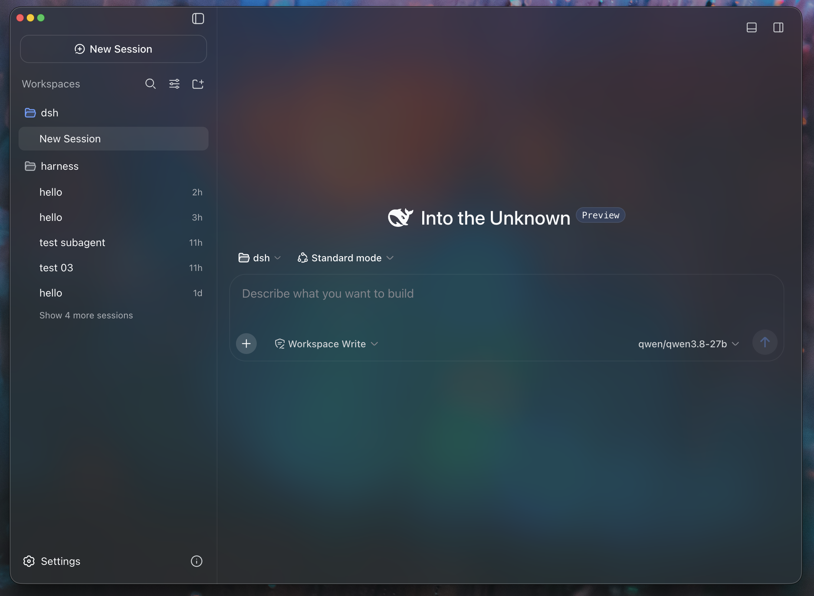
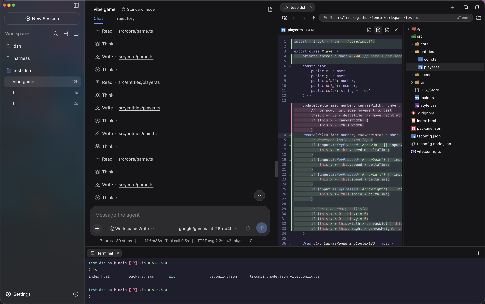
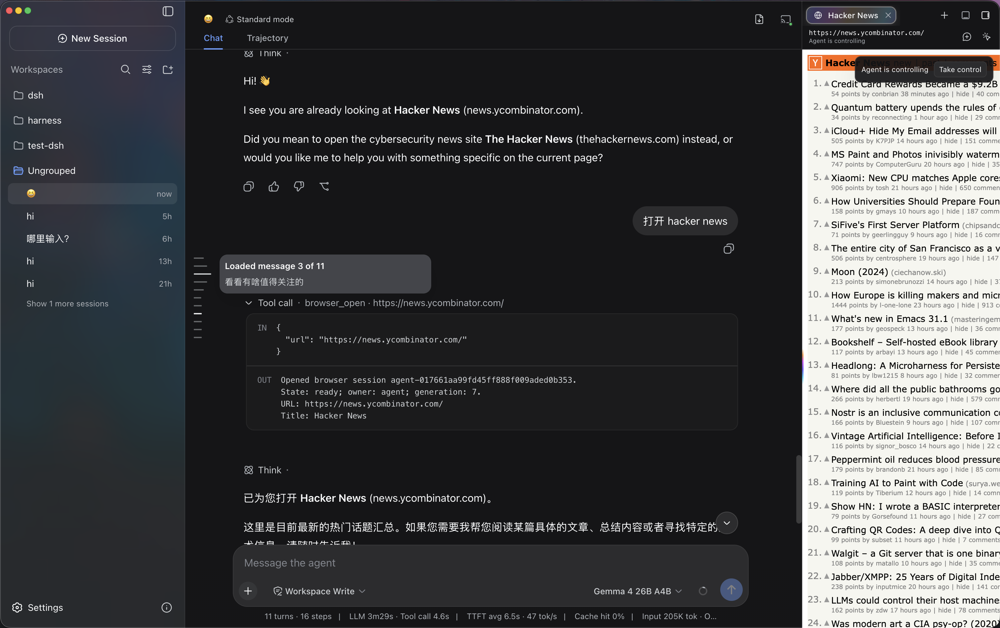
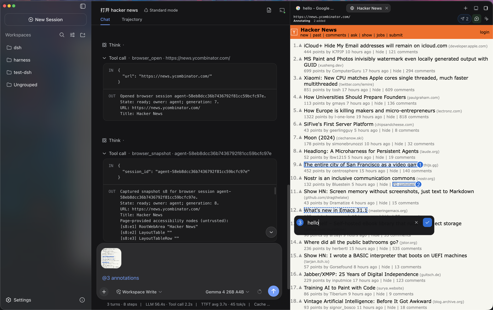
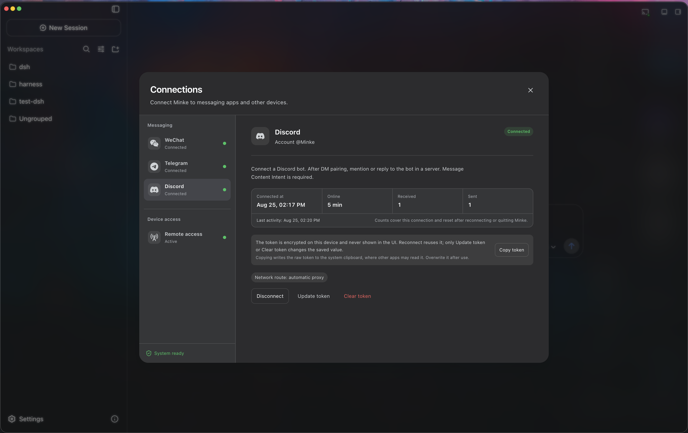
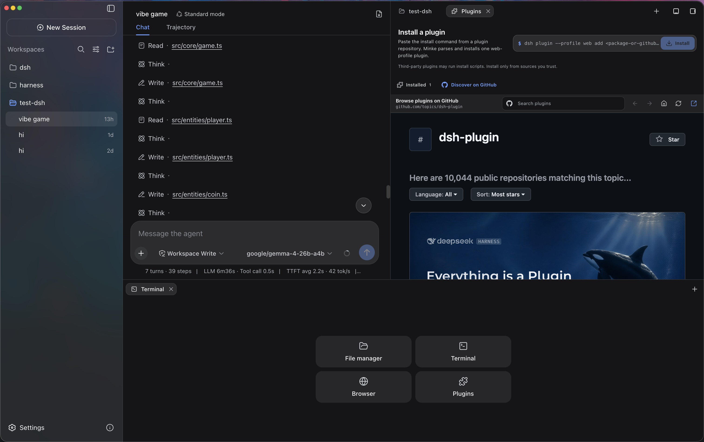
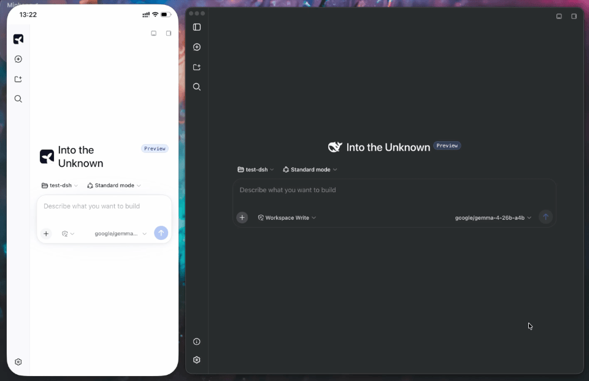

<p align="center">
  
</p>

<h1 align="center">Minke</h1>

<p align="center">
  <strong>基于 DeepSeek Harness 的本地优先桌面智能体工作空间</strong>
</p>

<p align="center">
  <a href="./README.md">English</a> · 简体中文
</p>

<p align="center">
  <a href="https://github.com/lencx/Minke/releases"></a>
  <a href="https://discord.gg/XMX5BEX8K"></a>
  <a href="https://x.com/lencx_"></a>
  <a href="https://www.buymeacoffee.com/lencx"></a>
</p>

Minke 是基于 [DeepSeek Harness](https://github.com/deepseek-ai/deepseek-harness) 的本地优先桌面智能体工作空间，将对话、文件、终端和浏览器整合在一起，支持 macOS、Windows 和 Linux。会话和配置保存在本机。

> Minke 是独立社区项目，正在持续开发中；已发布安装包可能与当前源码有所不同。

## 核心亮点

- **浏览器共同操作** — Agent 在可见的网页中执行任务，你可以随时接管，并将页面标注发回对话。
- **一体化工作空间** — 并排使用对话、文件和终端，通过分屏与底栏组织工作，直接编辑文件、预览文档和审阅修改。
- **跨设备访问** — 从手机或其他电脑通过 Web / PWA 访问工作空间，也可以通过微信、Telegram 和 Discord 发起任务。
- **云端与本地模型** — 使用云端模型或自定义接口，自动发现 LM Studio、Ollama 模型，并按需启动本地服务。
- **智能体与插件扩展** — 使用 DSH 的预设、技能、子代理和定时任务，通过原生插件管理扩展能力。

<table>
  <tr>
    <td width="50%"></td>
    <td width="50%"></td>
  </tr>
  <tr>
    <td width="50%"></td>
    <td width="50%"></td>
  </tr>
  <tr>
    <td width="50%"></td>
    <td width="50%"></td>
  </tr>
</table>

## 从其他设备远程访问

Minke 的远程访问是由 Minke Host 支撑的响应式 Web 客户端，并不是 Electron
窗口的视频流或触控投影。你可以在手机上继续对话、启动智能体任务、管理项目文件，
并使用实际运行在 Minke 电脑上的终端。



> [!NOTE]
> **Tailscale Serve HTTPS**、**Tailscale Direct IP** 和
> **Cloudflare Access** 均已完成端到端测试回归，目前都可以使用。

- **Tailscale Serve HTTPS（推荐）** — 适合已经加入同一 tailnet 的设备，提供安全的 HTTPS 地址，并支持安装 PWA。
- **Tailscale Direct IP（高级）** — 仅绑定当前设备的 Tailscale IPv4。流量仍由 Tailscale 端到端加密，但访问地址是 HTTP，不属于浏览器安全上下文。
- **Cloudflare Access** — 通过受身份策略保护的 Named Tunnel 从公网访问，手机无需安装 Tailscale；使用前需配置 Cloudflare Tunnel、Access 应用和允许访问的身份。

### 推荐方案：Tailscale Serve

Minke 可以通过 [Tailscale Serve](https://tailscale.com/docs/reference/tailscale-cli/serve) 私密地提供响应式 Web 界面。Harness 仍然只监听本机回环地址，不会暴露到局域网，也不会启用公开的 Tailscale Funnel。

1. 在运行 Minke 的电脑和手机上安装 Tailscale，登录同一个 tailnet，并确认电脑已连接。
2. 打开 Minke 的 **连接 → 设备访问 → 远程访问**，选择 **HTTPS Serve** 并启用远程访问。Minke 会在后台连接，无需重启应用。
3. 在手机上打开界面显示的 `https://…ts.net` 地址。

### 安装为 PWA

通过 Tailscale Serve 或 Cloudflare Access 的 HTTPS 地址打开远程页面，点击侧边栏中的
**安装 Minke**，并接受浏览器的安装提示。在 iPhone 或 iPad 上，请使用
**分享 → 添加到主屏幕**。
安装后会以独立应用模式启动；网络较差时会展示连接中或离线状态，而不是静默展示
缓存的工作空间内容。

Minke 同一时间只启用一条远程链路，并只在应用运行期间持有前台代理，退出时会将其停止。远程页面能够启动 Agent 任务，并使用 Minke 已授权的本机工具，因此请只允许可信的 tailnet 成员或 Cloudflare Access 身份访问。

## 安装

请仅从 Minke 官方 [GitHub Releases](https://github.com/lencx/Minke/releases) 页面下载安装包。

| 平台 | 架构 | 安装包 |
| --- | --- | --- |
| macOS | Apple Silicon（`arm64`） | `.dmg` |
| macOS | Intel（`x64`） | `.dmg` |
| Windows | `x64` | `.exe` |
| Linux | Debian / Ubuntu（`x64`） | `.deb` |
| Linux | Fedora / RHEL（`x64`） | `.rpm` |
| Linux | `x64`（便携 AppImage） | `.AppImage` |

打包后的 macOS、Windows 和 Linux 版本都会自动检查稳定更新。Minke 会为当前系统
选择名称固定的 DMG、EXE、DEB、RPM 或 AppImage，校验 GitHub 不可变 Release、
下载地址链、精确大小、SHA-256 和系统可用的来源属性，再询问是否打开。可在
**设置 → Minke → 偏好设置 → 软件更新** 中关闭后台下载；关闭后必须先确认“下载更新”。
也可随时在 **关于 Minke → 检查更新** 中手动触发。安装过程始终需要用户明确确认。
用户操作和各平台行为见[桌面应用更新说明](./docs/app-updates.md)。

### macOS

1. 下载并打开 `.dmg` 文件。
2. 将 `Minke.app` 拖入“应用程序”目录。
3. 当前预发布版本尚未经过 Apple 公证。请先尝试在 **系统设置 → 隐私与安全性** 中使用 Apple 提供的[“仍要打开”](https://support.apple.com/zh-cn/102445)流程。
4. 仅当你明确接受风险且系统流程不可用时，才对已安装应用的精确路径移除 quarantine：

   ```bash
   xattr -dr com.apple.quarantine "/Applications/Minke.app"
   ```

5. 从“应用程序”目录打开 Minke。

> [!CAUTION]
> 移除 quarantine 属性会绕过一项 macOS 安全检查。Minke 更新器绝不会自动执行该命令。请仅将它作为最后手段，对从官方 Releases 页面下载的 `Minke.app` 使用，并且不要把路径替换为宽泛目录。

#### 在 macOS 上授权凭据存储

Minke 仅在你打开**连接**并点击**授权凭据访问**后请求钥匙串权限。如果 macOS
弹出系统窗口，请输入 Mac 登录密码并选择**始终允许**；如果拒绝了访问，点击
**重新请求授权**即可。

如果凭据存储仍不可用，一种可能原因是应用签名无效或被修改，导致 macOS 无法
识别 Minke 的钥匙串身份。先校验应用：

```bash
codesign --verify --deep --strict --verbose=2 "/Applications/Minke.app"
```

如果可信的旧预发布构建校验失败，并且不便重新安装，请先完全退出 Minke，再修复
签名并重新打开：

```bash
/usr/bin/codesign --force --deep --sign - --timestamp=none "/Applications/Minke.app" \
  && /usr/bin/codesign --verify --deep --strict --verbose=2 "/Applications/Minke.app" \
  && /usr/bin/open "/Applications/Minke.app"
```

> [!WARNING]
> 临时重签会替换已安装应用的现有签名。不要对具有有效 Developer ID 签名且经过
> Apple 公证的版本执行；请改为重新安装官方构建。不要删除 `~/.minke/secrets`
> 或“钥匙串访问”中的 Minke Safe Storage 项，已有通道凭据依赖这些数据。

### Windows

1. 下载 Windows x64 `.exe` 安装程序。
2. 运行安装程序，并按照界面提示完成安装。
3. 新发布的预览版本可能触发 Windows 信誉安全提示。请先确认安装程序来自 Minke 官方 Releases 页面，再决定是否继续。

### Linux

根据发行版下载对应安装包，可以通过图形化软件管理器打开，也可以在终端中安装。

Debian / Ubuntu：

```bash
sudo apt install "/path/to/minke-package.deb"
```

Fedora / RHEL：

```bash
sudo dnf install "/path/to/minke-package.rpm"
```

请将示例路径替换为实际下载的安装包路径。

## 从源码构建

请在与目标安装包相同的操作系统和 CPU 架构上构建 Minke。构建产物位于 `out/make`，本项目不支持在单一宿主机上进行跨平台打包。

当前源码使用 **DSH v0.2.1-rc.3**。源码提交和应用的补丁记录在 [runtime 配置](./config/harness-runtime.json)中；功能变化和迁移事项见 [DSH 升级说明](./docs/dsh-upgrade.md)。

macOS 和 Linux 下，Minke 启动时会读取一次登录 shell 的环境，让工具、模型服务和插件命令使用其中的 PATH 与代理设置。每次 shell 尝试限时 10 秒，失败后尝试其他系统 shell，全部失败则沿用启动环境；可通过 `MINKE_LOGIN_SHELL_TIMEOUT_MS` 设置毫秒数。已选 Data Home 和 Minke 的运行时参数保持不变。

环境依赖：

- 支持 submodule 的 Git，并确保已检出 `vendor/deepseek-harness` 子模块。
- Node.js 24 或更高版本。
- pnpm 11.28.5；执行脚本前需已安装仓库依赖。
- macOS：Apple Silicon 或 Intel Mac，并安装 Xcode Command Line Tools；`.dmg` 只能在 macOS 上构建。
- Windows：Windows x64；如果原生依赖需要在本地编译，可能还需要安装 Visual Studio 2022 Build Tools，并选择 **Desktop development with C++** 工作负载。
- Linux：Linux x64，并安装原生编译工具链、`fakeroot`、`dpkg`，以及 `rpm` 或 `rpm-build`。

首次检出源码并安装仓库依赖后，先准备 Harness runtime：

```bash
pnpm run harness:stage
```

该命令会安装并构建项目固定版本的 DeepSeek Harness 源码，然后将可复用的桌面 runtime 生成到 `runtime/host`。首次检出源码，或固定的 Harness 源码及 runtime 契约发生变化后，需要执行一次。

使用开发模式启动 Minke：

```bash
pnpm start
```

`pnpm start` 会刷新已准备 runtime 中的 Minke 集成，并启动开发应用。校验通过且内容无变化时，会跳过产品包构建和 runtime 刷新；构建产物有修改或缺失时会重新构建或修复。

开发版将桌面设置和浏览器数据存入 `work/development/electron`，Harness 数据存入 `work/development/harness`，与正式版数据隔离；这些目录已被 Git 忽略。显式设置 `DSH_HOME` 可以覆盖开发版 Harness 目录，建议指定独立测试目录。

为当前平台生成安装包：

```bash
pnpm make
```

`pnpm make` 会先重新执行一次完整的 runtime 准备流程，再将当前平台的安装包生成到 `out/make`。

macOS 可选：使用同一个签名证书打包，可减少升级后的钥匙串重复授权提示：

```bash
MINKE_MACOS_SIGN_IDENTITY="Developer ID Application: …" pnpm make
```
